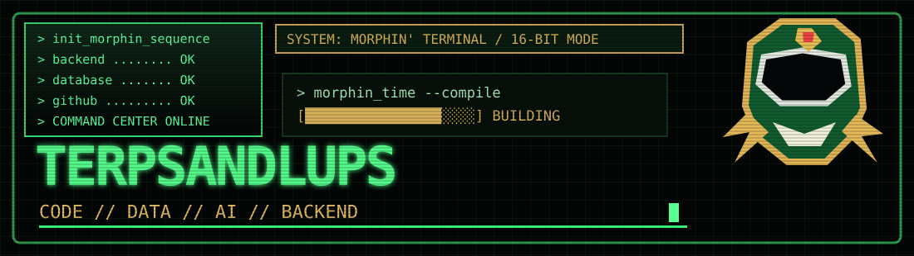

**[PROJECTS](#-mission-select--featured-projects) · [TECH STACK](#-loadout--technologies) · [ACTIVITY](#-system-monitor--github-activity) · [CONNECT](#-contact--connect)**

## `> whoami --professional`

**Software development student | Backend • Data Analytics • Retail Technology**

I turn real operational challenges into practical software projects. My background in **inventory control, auditing and loss prevention** informs the tools I build: applications for store operations, data analysis, dashboards, and workflow automation.

I'm studying **Systems Analysis and Development**, focusing on software engineering fundamentals, APIs, data modeling, backend systems and AI-assisted development. I value readable code, explicit business rules, testing and understanding how a system works before deploying it.

> **My approach:** understand the business problem → model the data → build a usable solution → validate the result.

<b>🇧🇷 Ler apresentação em português</b>

Sou estudante de Análise e Desenvolvimento de Sistemas, com experiência profissional em **controle de estoques, auditorias e prevenção de perdas no varejo alimentar**. Desenvolvo projetos práticos que conectam processos operacionais, dados e tecnologia. Meu foco de evolução está em **back-end, APIs, SQL/PostgreSQL, Python, JavaScript e inteligência artificial**, sempre buscando compreender a arquitetura, a lógica e as decisões técnicas do que construo.

### `> neofetch --developer`

## `> mission select --featured-projects`

### `01 / Z-AI — Retail Executive Dashboard`
**[Explore public repository](https://github.com/terpsandlups/Z-AI-Dashboard)**

An executive analytics application for retail operations, designed to bring together sales, inventory discrepancies, recognized losses, supplier exchanges and store-level KPIs.

`DATA ANALYTICS` · `DASHBOARDS` · `POSTGRESQL` · `SUPABASE`

**Engineering focus:** data ingestion, business metrics, historical comparisons, filters and decision-oriented visualization.

### `02 / Brasa Burger — Retail ERP`
**[Explore public repository](https://github.com/terpsandlups/BRASA_BURGER_CRUD_ERP)**

An ERP learning project built around operational workflows and business rules, with a focus on implementing and evolving practical management features.

`ERP` · `CRUD` · `BACKEND` · `BUSINESS RULES`

**Engineering focus:** structured data, CRUD operations, workflow consistency and maintainable functionality.

### `03 / Behind the scenes — Experiments & ongoing work`

| Project | Problem being explored | Visibility |
|:--|:--|:--|
| **EstudaLab IA** | Study platform and AI-assisted question generation | Private development |
| **Gestão de Validades** | Product expiration monitoring and store-level workflows | Private development |
| **MercadoLab 360** | Omnichannel retail, GTIN product registration and API architecture | In planning |

*Private projects are described as areas of ongoing work, not public demonstrations or completed releases.*

## `> loadout --technologies`

| Domain | Tools and technologies |
|:--|:--|
| **Languages** | Python, JavaScript, SQL, PHP |
| **Data & backend** | PostgreSQL, MySQL, Node.js, REST APIs |
| **Deployment & workflow** | Git, GitHub, Vercel, Netlify, Supabase |
| **Learning & exploration** | TypeScript, data pipelines, AI integrations, automated tests |

## `> system monitor --github-activity`

Statistics are provided by a third-party service; availability can vary. Language percentages represent repository code, not skill level.

## `> activate arcade --contributions`

Contribution animation uses [Platane/snk](https://github.com/Platane/snk). It is available after the workflow completes and publishes the output branch.

## `> roadmap --next-level`

- [x] Create public profile README and retro visual identity
- [x] Showcase public projects and explain their real-world purpose
- [x] Add technology stack and developer introduction
- [x] Configure contribution snake workflow
- [ ] Publish deeper technical case studies with architecture, screenshots and setup instructions
- [ ] Expand public API projects with tests, documentation and deployment examples

## `> contact --connect`

**GitHub:** [@terpsandlups](https://github.com/terpsandlups)  
**Highlighted work:** [Z-AI Dashboard](https://github.com/terpsandlups/Z-AI-Dashboard) · [Brasa Burger ERP](https://github.com/terpsandlups/BRASA_BURGER_CRUD_ERP)

---

`[ ANALYZE ]` → `[ DESIGN ]` → `[ BUILD ]` → `[ TEST ]` → `[ DEPLOY ]`

**`MAY THE SOURCE BE WITH YOU.`**

Retro arcade aesthetics. Real projects. Continuous learning.

