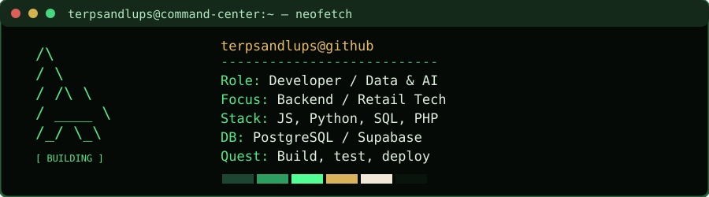

### `> boot sequence: developer.exe`

### `> whoami`

I'm building useful software at the intersection of **backend engineering, data analytics, artificial intelligence and retail technology**. I enjoy understanding the full pipeline: from SQL modeling and APIs to testing, deployment and reliable dashboards.

- `CURRENT QUEST` — Become a stronger software engineer through real-world projects.
- `CORE LOOP` — Study → build → test → refactor → deploy.
- `FOCUS` — JavaScript, Node.js, Python, SQL, PostgreSQL, integrations and AI.
- `BONUS XP` — Retail operations, inventory intelligence and applied analytics.

### `> inventory --skills`

### `> mission select`

| MISSION | TECH / OBJECTIVE | STATE |
|:---|:---|:---:|
| [**Z-AI Dashboard**](https://github.com/terpsandlups/Z-AI-Dashboard) | Retail analytics, dashboards, PostgreSQL/Supabase | `ACTIVE` |
| **EstudaLab IA** | Question generation and AI-powered learning | `BUILDING · PRIVATE` |
| **Gestão de Validades** | Expiration-date management and store workflows | `BUILDING · PRIVATE` |
| [**Brasa Burger ERP**](https://github.com/terpsandlups/BRASA_BURGER_CRUD_ERP) | Retail ERP and operational workflows | `ACTIVE` |
| **MercadoLab 360** | Omnichannel retail, GTIN APIs and data platform | `PLANNED` |

### `> git status --all`

### `> activate arcade mode`

The contribution snake appears once the GitHub Action has run successfully.

---

`[ BUILD ]` • `[ TEST ]` • `[ REFACTOR ]` • `[ DEPLOY ]`

**`MAY THE SOURCE BE WITH YOU.`**

